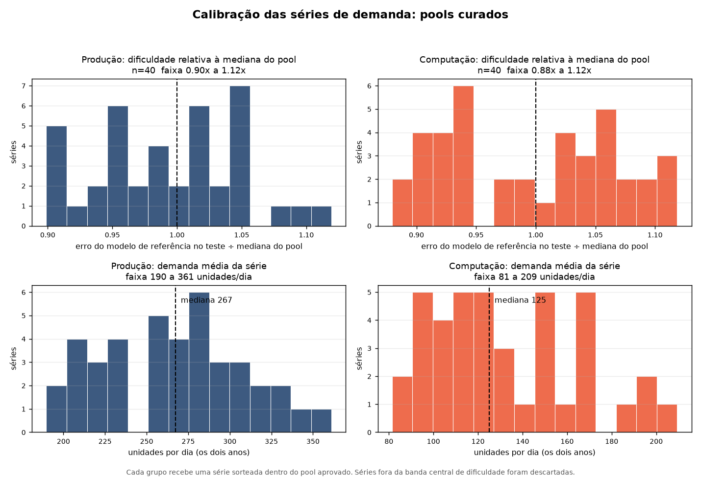

# Projeto 2 (P2) — Inteligência Artificial 1

**Valor:** 10 pontos  
**Grupos:** os mesmos do Projeto 1  
**Apresentação do projeto:** 17/11/2026  
**Sessão de pôsteres:** 01/12/2026

---

## 1. O que este projeto avalia

Como no P1, este projeto não avalia a implementação de código. Isso pode
ser feito com a ajuda de IA. Os modelos e a rede neural já estão prontos
no repositório base, com o backpropagation escrito à mão e comentado, e
vocês podem usá-los.

O que vale nota é projetar medições, explicar os resultados (em
especial os que contrariam o que vocês esperavam) e mostrar,
individualmente, que entendem o que o grupo fez.

Os grupos são os mesmos do Projeto 1. Cada grupo recebe **uma série de
demanda própria**, escolhida pela mesma matrícula usada no P1 (a do
integrante mais velho). Os números que vocês vão obter não existem em
nenhum outro lugar.

```
python minha_serie.py <matricula> <producao|computacao>
```

As séries foram curadas para que nenhum grupo receba uma série
significativamente mais difícil que a dos colegas. A distribuição de
dificuldade está em `histograma_calibracao.png`:



---

## 2. O contexto

O centro de distribuição do P1 também atende uma família de produtos
refrigerados. Todo fim de tarde, duas decisões são tomadas para o dia
seguinte:

- **quanto estocar.** O que sobra no fim do dia é descartado e custa
  R$ 1,00 por unidade. O que falta é venda perdida e custa R$ 4,00 por
  unidade.
- **se a doca extra abre.** A doca normal recebe até uma certa quantidade
  por dia (a *capacidade*, diferente em cada série). Acima disso, é
  preciso abrir a doca extra.

As duas decisões dependem de uma previsão da demanda de amanhã.

### Os dados

Cada série tem dois anos de demanda diária, de 01/01/2024 a 31/12/2025,
dividida em três partes:

| Parte     | Período                 | Dias | Vocês recebem |
| --------- | ----------------------- | ---- | ------------- |
| treino    | 01/01/2024 a 30/06/2025 | 547  | sim           |
| validação | 01/07/2025 a 30/09/2025 | 92   | sim           |
| teste     | 01/10/2025 a 31/12/2025 | 92   | **não**       |

O teste fica com o professor e só é usado no placar (seção 5). Ele inclui
a Black Friday e o Natal. A validação, não.

Cada linha do CSV é um dia:

| Coluna            | O que é                                                         |
| ----------------- | --------------------------------------------------------------- |
| `data`            | `AAAA-MM-DD`                                                    |
| `dia_semana`      | 0 = segunda ... 6 = domingo                                     |
| `feriado`         | 1 se é feriado nacional                                         |
| `vespera_feriado` | 1 se o dia seguinte é feriado                                   |
| `evento`          | 1 em dias de campanha do varejo (Black Friday, semana do Natal) |
| `promocao`        | 1 se o produto está em promoção                                 |
| `desconto`        | fração de desconto (0,20 = 20%)                                 |
| `preco`           | preço praticado no dia, já com o desconto (R$)                  |
| `temperatura`     | temperatura média prevista para o dia (°C)                      |
| `demanda`         | unidades pedidas ao centro de distribuição                      |

Tudo menos `demanda` é conhecido na véspera. É isso que permite prever.

### Como ler a sua série

`minha_serie.py` resume a série. Este é um trecho da saída para a
matrícula de exemplo `20231234`, curso Computação (série 52):

```
parte           período                    dias    média   mín   máx
treino          2024-01-01 a 2025-06-30     547     91,4    19   518
validacao       2025-07-01 a 2025-09-30      92     87,1    13   323
teste (oculto)  2025-10-01 a 2025-12-31      92        ?     ?     ?

capacidade da doca normal: 126 unidades/dia
  dias acima dela (doca extra): 14,8% do treino, 9,8% da validação
dias de promoção: 55 no treino, 13 na validação

demanda média por dia da semana (treino):
  seg 102  ter 96  qua 96  qui 94  sex 131  sáb 80  dom 41
```

A saída completa traz também a demanda média de cada mês, em barras, e as
primeiras linhas do CSV.

- A capacidade é o percentil 85 da demanda de treino. Por construção, a
  doca extra é necessária em cerca de 15% dos dias de treino. Na
  validação a fração muda, e isso já é um dado.
- A série tem tendência, sazonalidade semanal e anual, promoções, efeito
  de temperatura, feriados e, raramente, pedidos atípicos muito grandes.
  Quais desses efeitos importam, e quanto, é o que vocês vão descobrir.

### Features: o que o modelo enxerga

Todo modelo deste projeto recebe as mesmas entradas: uma lista de números
por dia, calculada por uma função de features

```python
def features(hist, dia):
    ...
    return [ ... ]   # lista de números, sempre do mesmo tamanho
```

- `hist` são os dias **anteriores**, com a demanda. `hist[-1]` é ontem,
  `hist[-7]` é o mesmo dia da semana passada.
- `dia` é o dia a prever, com todas as colunas menos `demanda`.

`hist` termina na véspera: a função não consegue ver o futuro. Por isso
não há vazamento de dados do futuro neste projeto. Os primeiros 28 dias
de cada série nunca são previstos, só servem de histórico, então
`hist[-28]` sempre existe. Para olhar mais longe (por exemplo,
`hist[-364]`, o mesmo dia do ano passado), confiram `len(hist)` antes:
nos primeiros meses esse dia não existe.

`engine/features.py` traz três funções prontas: `calendario`,
`defasagens` e `basicas` (as duas juntas, mais promoção e temperatura).

---

## 3. Módulo 1 — Aprendizado de máquina

### O problema

Duas tarefas, com as mesmas features:

- **Regressão:** prever a demanda de amanhã.
- **Classificação:** prever se amanhã a demanda passa da capacidade, ou
  seja, se a doca extra vai ser necessária.

### O que vocês fazem

Rodem os modelos já implementados em `engine/modelos.py`, treinando no
treino e medindo na validação:

| Modelo                                       | Tarefa        | Registrar                          |
| -------------------------------------------- | ------------- | ---------------------------------- |
| Ingênuo, ingênuo sazonal, média móvel        | regressão     | MSE, viés                          |
| Regressão linear (com e sem l2)              | regressão     | idem                               |
| k-NN (k = 1, 5, 25)                          | regressão     | idem                               |
| "Sempre não"                                 | classificação | acurácia, precisão, revocação, F1  |
| Regressão logística (limiares 0,5, 0,25, 0,1) | classificação | idem                              |

MSE é o erro quadrático médio, em unidades². A raiz dele (RMSE) volta
para unidades de demanda e é mais fácil de ler. Viés é a soma de
(previsão − demanda) dividida pela soma da demanda, em %: positivo quer
dizer que o modelo prevê acima. As três estão em `engine/metricas.py`.

Comparem também uma **validação interna aleatória** com uma **validação
interna temporal**: separem 20% do treino, sorteados ou do fim do
período, e vejam qual das duas estima melhor o erro que vocês mediram na
validação de verdade (`engine.dados.dividir`).

### Ênfase por curso

**Computação.** A série tem tendência. Mostrem com os seus números por que
o k-NN não consegue prever um nível de demanda que nunca apareceu no
treino, e meçam o viés que isso produz. Expliquem por que, nesta série,
a divisão aleatória e a temporal dão (ou não dão) estimativas diferentes.

**Produção.** Abrir a doca extra sem necessidade custa R$ 300 (equipe
parada). Não abrir quando é preciso custa R$ 1.500 (caminhões esperando,
horas extras). Escolham o limiar da regressão logística que minimiza esse
custo na validação e respondam com número: quanto o centro economiza por
mês em relação a "sempre não"?

---

## 4. Módulo 2 — Redes neurais

### O problema

A mesma previsão de demanda, agora com o perceptron multicamada de
`engine/rede.py`. A rede é pequena e escrita em numpy, sem biblioteca de
aprendizado: o passo para frente, o backpropagation e os otimizadores
estão no arquivo, comentados, para vocês lerem.

```python
from engine.rede import MLP, checar_gradiente

rede = MLP(camadas=[16], ativacao="relu", perda="mse").treinar(X, y, X_val, y_val)
rede.prever(X_val)
rede.historico["perda_treino"], rede.historico["perda_val"]   # por época
rede.historico["divergiu"]     # True se a perda virou nan ou infinito
```

### O que vocês fazem

| Eixo                         | Níveis                                                 |
| ---------------------------- | ------------------------------------------------------ |
| Ativação das camadas ocultas | identidade, sigmoide, tanh, ReLU                       |
| Perda                        | MSE, MAE, Huber, pinball (quantis 0,5 e 0,8)           |
| Taxa de aprendizado (SGD)    | de 0,001 a 1                                           |
| Profundidade                 | 1 camada oculta contra 4, com sigmoide e com ReLU      |

Registrem, para cada configuração: MSE, viés, custo do estoque e as
curvas de perda de treino e de validação por época.

**Toda configuração roda com pelo menos 3 sementes.** Duas redes iguais
com sementes diferentes dão resultados diferentes, e essa variação é
parte do dado. Uma execução que divergiu (perda `nan` ou infinita) é
reportada como **divergiu**, com a taxa anotada. Não omitam a linha.

Além da rede:

- **Perceptron contra regressão logística** na doca extra. Registrem o
  número de erros por época do perceptron (`historico["erros"]`).
- **Checagem do gradiente.** Rodem `checar_gradiente` em pelo menos duas
  combinações de ativação e perda, e expliquem o que o número significa.

Depois, **montem a submissão ao placar**: as features e a configuração
da rede que vocês acham que vão generalizar melhor (seção 5).

### Ênfase por curso

**Computação.** Escrevam à mão o gradiente da perda em relação a um peso
da primeira camada, para a ativação e a perda da submissão de vocês, e
confiram com `checar_gradiente`. Mostrem, nas curvas de perda, em que
época a rede passa a decorar o treino em vez de generalizar.

**Produção.** A função de perda é uma decisão de negócio. Comparem a rede
treinada com MSE mais um estoque de segurança e a rede treinada com perda
pinball no quantil crítico (com falta a R$ 4 e sobra a R$ 1, o quantil é
4 / (4 + 1) = 0,8). Respondam com número: quanto o centro economiza por
mês com a perda pinball em relação à MSE pura, e quanto dessa economia
um estoque de segurança simples já recupera?

---

## 5. Placar da turma

Este é o elemento que vocês não controlam.

Em **24/11** cada grupo submete um arquivo. Em **25/11** eu treino **todas
as submissões da turma nas 30 primeiras séries do pool**, não apenas na
série de origem, meço no teste oculto e publico as tabelas com os
resultados por série.

### Como o placar treina e mede

- A rede é treinada no treino + validação de cada série, com 3 sementes.
  A métrica de cada série é a média das três.
- O teste é previsto dia a dia, como na operação: para prever 15/11, a
  função de features recebe o histórico até 14/11, com a demanda real.
  A rede não é retreinada durante o teste.
- Previsão negativa vira zero.

### Contrato de submissão

`submissao/previsor.py`

```python
NOME = "nome do grupo"

CONFIG = {
    "camadas": [16],       # neurônios por camada oculta; [] = modelo linear
    "ativacao": "relu",
    "perda": "mse",
    "otimizador": "adam",
    "taxa": 0.01,
    "epocas": 200,
    # ... as chaves estão comentadas no arquivo
}

def features(hist, dia):
    return [...]

# opcional: quanto estocar, dada a previsão. Só afeta o custo do estoque.
def decidir(previsao, hist, dia):
    return previsao
```

Limites: até 4 camadas ocultas de até 64 neurônios, até 500 épocas, até
100 features, 60 segundos por série. O arquivo só pode importar `math`,
`statistics`, `datetime`, `itertools`, `functools`, `collections`,
`bisect` e `heapq`, não pode abrir arquivos e não pode usar `getattr`,
`.format` nem atributos que começam com `_`. A lista completa está em
`engine/avaliacao.py`, e o verificador aponta qualquer violação.

### O que a tabela mostra

Para cada submissão: RMSE relativo (média, mediana e pior série), viés,
custo do estoque por 100 unidades demandadas (média e mediana), fração da
demanda atendida, séries com falha e séries censuradas.

O **RMSE relativo** é a raiz do MSE dividida pela demanda média do
período, em %. A divisão existe só para comparar séries de volumes
diferentes: um RMSE de 20 unidades é muito numa série que vende 80 por
dia e pouco numa que vende 300.

Duas referências entram na tabela: a rede de exemplo do repositório e o
modelo linear (sem camada oculta) com as mesmas features.

**Como as tabelas são ordenadas.** Primeiro as submissões com menos
séries com falha ou censura. Depois, em Computação, pelo RMSE relativo
médio; em
Produção, pelo custo médio do estoque. As duas colunas aparecem nos dois
cursos. A média é usada de propósito, porque penaliza o desempenho
catastrófico em poucas séries, e uma previsão que erra feio às vezes é um
problema na operação. A mediana aparece ao lado para mostrar o caso
típico. Quando as duas contam histórias diferentes, isso é material para
o pôster, não um erro da tabela.

### Política de falhas

| Evento                                                          | Consequência            |
| --------------------------------------------------------------- | ----------------------- |
| Import ou nome não permitido, `NOME` vazio, `CONFIG` inválida   | submissão desqualificada |
| Exceção em `features` ou `decidir`                               | série com falha         |
| `features` muda de tamanho de um dia para outro                  | série com falha         |
| A rede diverge (perda `nan` ou infinita)                         | série com falha         |
| As features de um dia mudam quando a demanda daquele dia em diante muda | série com falha  |
| Mais de 60 s numa série                                          | série censurada         |

O placar não vale colocação. Vale 0,5 ponto pela submissão válida, e os
dados que ele gera são material obrigatório do pôster.

---

## 6. Calendário

OBS: Nenhum prazo é flexível.

| Data                 | Evento                                                                    |
| -------------------- | ------------------------------------------------------------------------- |
| **Ter 17/11**        | Apresentação. Séries distribuídas, repositório publicado                  |
| 17 a 23/11           | Experimentação                                                            |
| **Ter 24/11, 23h59** | Submissão ao placar (Canvas)                                              |
| Qua 25/11            | Placar rodado. Tabelas e resultados por série publicados (Canvas)         |
| 26 a 29/11           | Análise cruzada, relatório e pôster                                       |
| **Dom 29/11, 23h59** | Pacote reprodutível, relatório e pôster (Canvas)                          |
| **Ter 01/12**        | Pôsteres e questionário individual no Canvas                              |

Perdeu 24/11, não há placar para o seu grupo. Não há segunda chance,
porque é uma execução coletiva única.

---

## 7. Pacote reprodutível (29/11)

- código-fonte
- dados brutos de todas as execuções, uma linha por semente, sem
  filtragem, incluindo as que divergiram
- um script único que regenera todos os números e gráficos do pôster e
  do relatório
- `README.md` com o comando exato

O professor vai rodar esse script. Se ele não rodar com um comando, ou se
os números não baterem com o pôster e o relatório, o pacote perde nota
(ver a [rubrica](RUBRICA.md)).

---

## 8. Relatório (29/11)

No máximo três páginas, em PDF, entregue junto com o pacote. O conteúdo
muda com o curso.

**Computação: relatório de ablação.** Partam da submissão final. Retirem
(ou voltem ao padrão) um componente por vez, entre features e itens da
`CONFIG`, e meçam o efeito na validação com pelo menos 3 sementes por
variante. Ao menos quatro componentes. Reportem a variação entre
sementes ao lado de cada efeito: um ganho menor que essa variação não é
um ganho.

**Produção: análise de custo do estoque.** Meçam como o custo varia com
a regra de estoque, nas duas famílias: rede com perda pinball em vários
quantis, e rede com MSE mais um estoque de segurança de vários tamanhos.
Repitam com ao menos três razões entre custo de falta e custo de sobra
(a do enunciado e mais duas). Terminem com uma recomendação em reais.

---

## 9. Política de uso de IA generativa

**Não há proibição para uso de IA Generativa.**

Há uma exigência de 0,5 ponto: um anexo de no máximo uma página
documentando **ao menos um caso em que a IA generativa errou e como vocês
detectaram**.

Exemplos:

- derivada da sigmoide ou da perda pinball escrita com o sinal errado, e
  a checagem que revelou
- a afirmação de que a rede sempre vence o modelo linear
- confusão entre o que MSE e MAE estimam
- feature sugerida que olha o futuro (média móvel centrada) e que o
  `hist` não permite calcular
- número plausível mas inventado, que não bateu quando vocês rodaram

Grupo que entregar "a IA acertou tudo" está declarando que não verificou
nada. Isso é nota baixa, não isenção.

---

## 10. Aula de 01/12

**Primeira parte.** Visitação virtual dos pôsteres, circulação livre.

Pôster digital no formato A1, feito a partir do
[modelo no Google Drive](https://docs.google.com/presentation/d/1M9LdyMc0VCf2wHs57rbcaywk1BjIJCFE/copy).
Quem colocar texto demais não vai conseguir explicar nada.

**Segunda parte.** Questionário individual no Canvas. O Canvas sorteia,
para cada aluno, três questões do [banco público](BANCO_PERGUNTAS.md),
respondidas por escrito durante a aula. Várias questões pedem os números
do grupo: tenham o pôster e os dados à mão. Avalia-se o conteúdo da
resposta, não a redação.

---

## 11. Distribuição dos 10 pontos

| Componente                                 | Pontos | Tipo       |
| ------------------------------------------ | ------ | ---------- |
| Submissão válida ao placar                 | 0,5    | grupo      |
| Pacote reprodutível                        | 1,5    | grupo      |
| Anexo de auditoria de IA                   | 0,5    | grupo      |
| Relatório (ablação ou custo do estoque)    | 1,5    | grupo      |
| Pôster e análise                           | 2,5    | grupo      |
| Questionário individual (Canvas)           | 3,5    | individual |

**Multiplicador do questionário.** A nota individual também funciona como
multiplicador sobre os 6,5 pontos coletivos, variando de 0,5 a 1,0.

```
nota final = (pontos coletivos × multiplicador) + nota do questionário
```

Quem não consegue explicar o próprio trabalho não carrega a nota do grupo.

Os critérios de correção de cada componente e a tabela do multiplicador
estão na [rubrica](RUBRICA.md).

---

## 12. Ambiente técnico

- Python 3.10 ou superior
- `numpy` é necessário para a engine (está no `requirements.txt`)
- `pandas` e `matplotlib` liberados para análise e gráficos
- O arquivo submetido ao placar usa só a biblioteca padrão, com os
  módulos da seção 5
- Repositório base em `engine/`

---

## 13. Onde gastar o tempo

O erro mais provável em duas semanas é gastar dez dias trocando features
e hiperparâmetros e quatro olhando para os resultados. Inverta.

Os modelos estão prontos. O trabalho que vale nota é medir, comparar,
encontrar o resultado que contraria a expectativa e explicá-lo.

Três resultados bem explicados valem mais que dez tabelados.
